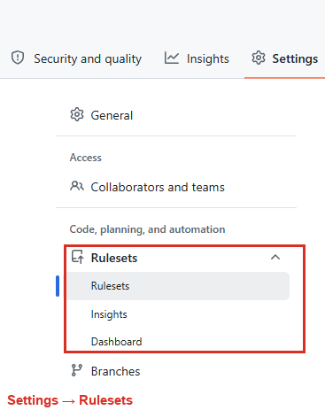
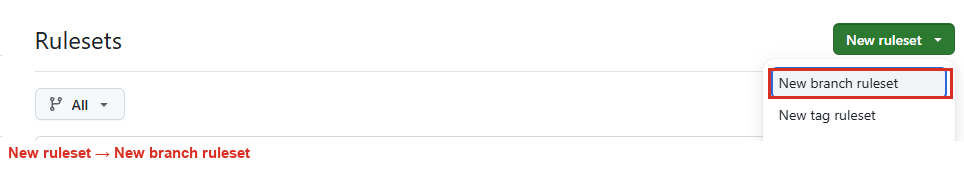
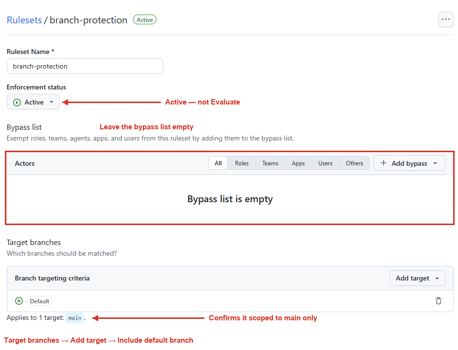
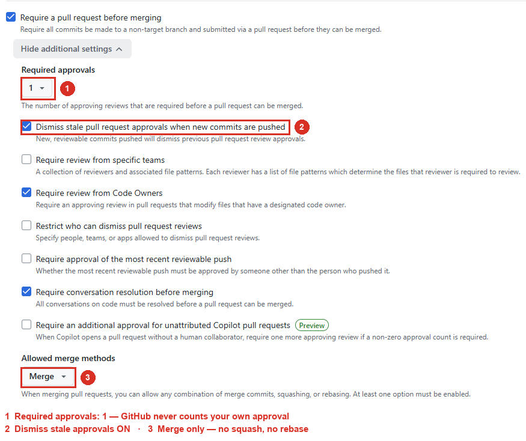
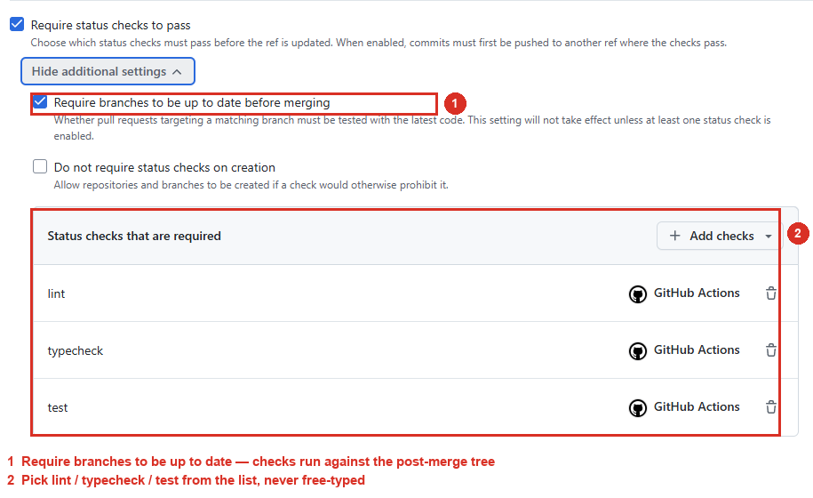
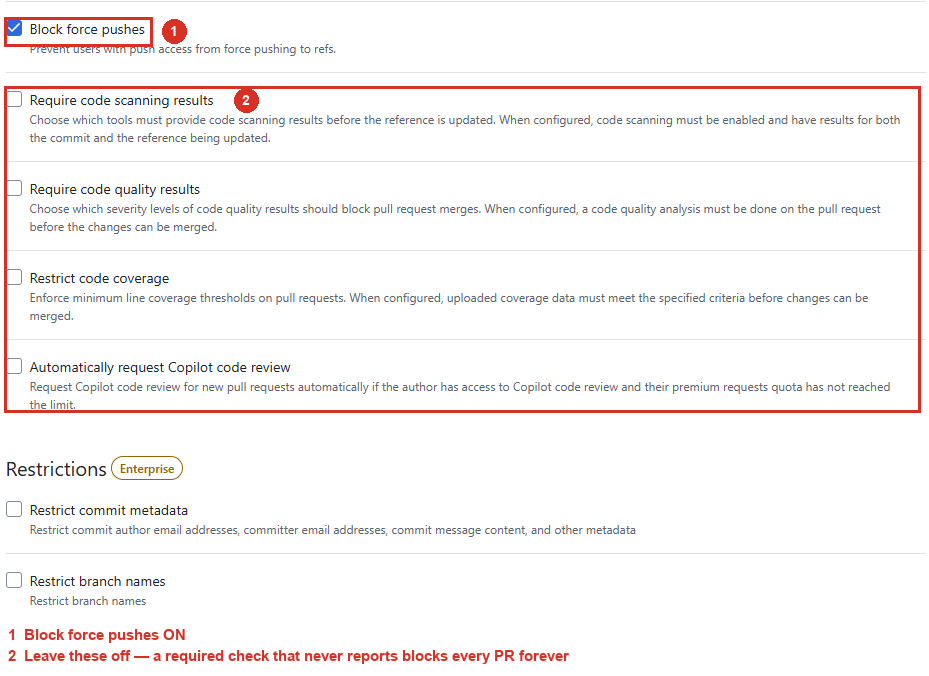

# Setting Up Branch Protection

How to protect `main` using GitHub **Rulesets**. Written 2026-09-01 against
`cbs-test-development/robat-reader-v2`; the same steps apply to any team repo.

## The standard

Branch protection is firm, not per-repo taste — a check nobody requires is a
suggestion. On `main`, in every repo:

- Require a pull request before merging, with at least one approval
- Require status checks to pass: `lint`, `typecheck`, `test`
- Require branches to be up to date — otherwise two independently-green PRs
  merge into a broken `main`
- No force pushes, no deletions

## Prerequisites

1. **Admin on the repo.** With only Write access, Settings shows no **Rules**
   entry. The org owner grants it.
2. **CI has run at least once.** Rulesets don't make checks run — the workflow
   file does. Once a PR has triggered
   [.github/workflows/ci.yml](../.github/workflows/ci.yml), GitHub knows the
   names `lint`/`typecheck`/`test` and offers them in the picker. The field also
   accepts free text, but a required check that never reports leaves every PR
   stuck on "Expected — waiting for status", so always pick from the list.

## Step 1 — Create the ruleset

**Settings → Rules → Rulesets**



Then **New ruleset → New branch ruleset**.



| Field | Value |
| --- | --- |
| Ruleset Name | `branch-protection` |
| Enforcement status | **Active** |
| Bypass list | *empty* |

## Step 2 — Target branches

**Add target → Include default branch**, which scopes the ruleset to `main`.
The page confirms this with *Applies to 1 target: `main`*.



## Step 3 — Rules

| Rule | Value |
| --- | --- |
| Restrict deletions | on |
| **Require a pull request before merging** | on |
| &nbsp;&nbsp;→ Required approvals | **1** |
| &nbsp;&nbsp;→ Dismiss stale approvals when new commits are pushed | on |
| &nbsp;&nbsp;→ Require review from Code Owners | on |
| &nbsp;&nbsp;→ Require conversation resolution before merging | on |
| &nbsp;&nbsp;→ Allowed merge methods | **Merge** only |
| **Require status checks to pass** | on |
| &nbsp;&nbsp;→ Required checks | `lint`, `typecheck`, `test` |
| &nbsp;&nbsp;→ Require branches to be up to date before merging | on |
| Block force pushes | on |

Leave everything else off. Then **Create**.







### The non-obvious ones

- **Empty bypass list** — bypass is all-or-nothing, exempting an actor from the
  whole ruleset rather than one rule. Editing the ruleset is the escape hatch.
- **Default branch only** — the PR rule blocks *direct pushes* to whatever it
  targets, so targeting all branches would make your own feature branches
  unpushable.
- **Merge only** — squash flattens deliberately-sliced commits; rebase rewrites
  SHAs and orphans annotated `vx.x.x` tags, which are the link between a shipped
  exe and its source.
- **Approvals = 1** — GitHub never counts a self-approval, so this genuinely
  requires a second person. It is the standard's floor.
- **Up to date = on** — guarantees the checks ran against the tree that will
  exist after the merge. Matters here because `tests/` pins an exact-match
  golden.
- **Require linear history** and **require signed commits** stay off: the first
  bans merge commits, the second hard-blocks every commit until signing is set up.

## Step 4 — Optional: protect release tags

Same page, **New tag ruleset**, target `v*`, enable only **Restrict deletions**
and **Block force pushes**. A released tag never moves, so this costs nothing and
keeps exe provenance verifiable.

## After it's on

Rulesets are not retroactive — nothing already on `main` changes. Going forward:

```powershell
git switch main
git pull
git switch -c feature/short-description
# ...edit, commit...
git push -u origin feature/short-description
```

Open the PR (this is what triggers CI — pushing a branch does not), wait for the
three checks, get one approval, merge with **Create a merge commit**. If `main`
moves meanwhile, press **Update branch** and let the checks re-run. Tag pushes
are unaffected by a branch ruleset.

Confirm it actually enforces:

```powershell
git switch main                       # the reset below is destructive on the wrong branch
git pull
git commit --allow-empty -m "probe: verify ruleset"
git push origin main                  # must be REJECTED
git reset --hard origin/main          # discard the probe commit
```

If the push unexpectedly succeeds, the probe commit is on `main` and you can no
longer remove it with a force push — you just blocked those. Revert it through a
PR, and check Enforcement status is **Active**, the target resolved, and you are
not on the bypass list.

## Troubleshooting

| Symptom | Cause |
| --- | --- |
| No **Rules** in the Settings sidebar | You have Write, not Admin. |
| Check name missing from the picker | It has never run — open a PR first. |
| PR stuck on "Expected — waiting for status" | A required check never reports: renamed job, or a `paths` filter excluded it. |
| Merge button greyed out with checks green | Missing approval, unresolved conversation, or branch out of date. |
| Checks re-run on a PR you didn't touch | Expected — someone merged to `main`. |
| Your own approval doesn't count | By design. |

## Reusing this elsewhere

Only the check names and merge method are repo-specific. Check names come from
each job's `name:` in the workflow; everything else transfers unchanged.
